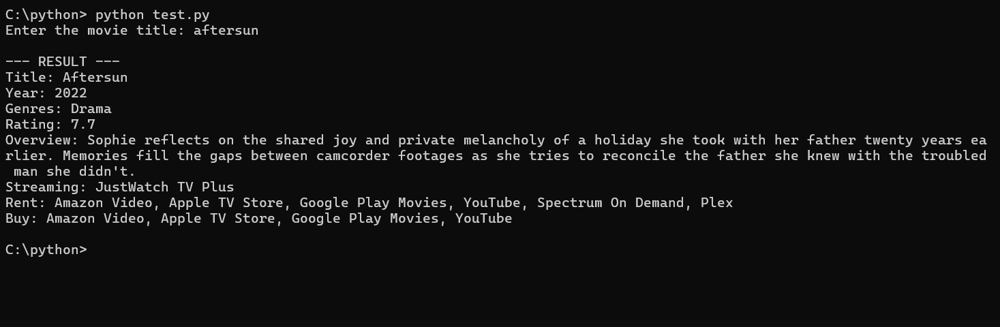

# Movie Lookup CLI

A lightweight Python command-line tool that queries the [TMDB API](https://www.themoviedb.org/) to fetch movie metadata—including title, release year, genres, rating, overview, and regional watch availability (streaming, rent, and buy).

## Features

- Searches movies by title via TMDB (`/search/movie`)
- Retrieves full movie details and genres (`/movie/{id}`)
- Checks regional availability for streaming, rent, and purchase (`/movie/{id}/watch/providers`)
- Loads authentication securely from environment variables (`.env`) using Bearer token auth

## Requirements

- Python 3.10+
- A TMDB account and **API Read Access Token**

Install dependencies:

```bash
pip install httpx python-dotenv
```

## Setup

1. Create a `.env` file in the project root (do not commit this file):

```env
TMDB_READ_TOKEN=your_tmdb_read_access_token_here
```

2. Make sure `.env` is listed in your `.gitignore`:

```gitignore
.env
__pycache__/
```

## Usage

Run the script from the terminal:

```bash
python teste.py
```

Enter a movie title when prompted (defaults to `Aftersun` if left blank):

```text
Enter the movie title: Aftersun

--- RESULT ---
Title: Aftersun
Year: 2022
Genres: Drama
Rating: 7.7
Overview: Sophie reflects on the shared joy and private melancholy of a holiday she took with her father twenty years earlier...
Streaming: ...
Rent: ...
Buy: ...
```



## Notes

- Watch provider availability depends on TMDB regional data and may vary over time.
- If you rename `teste.py` (for example, to `main.py`), update the run command accordingly.
